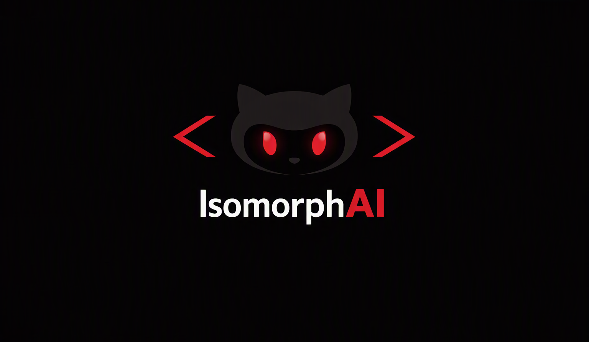
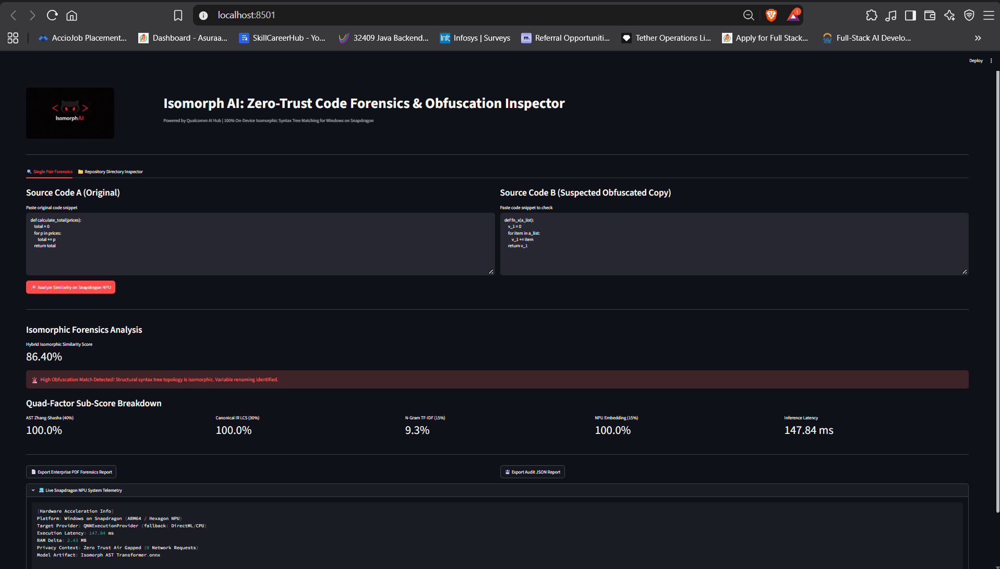

<div align="center">



# 🛡️ IsomorphAI

### Structural Code Forensics & Obfuscation-Resistant Similarity Analysis

**Offline-first source-code analysis for Windows on Snapdragon and Qualcomm AI-capable devices**

<br>


<br>

> **Compare code by structure, not just by text.**
>
> IsomorphAI combines AST tree similarity, canonical structural sequences, n-gram overlap, and optional neural embeddings to analyze source-code similarity under common transformations such as identifier renaming and formatting changes.

</div>

---

# 📑 Table of Contents

* [Overview](#-overview)
* [Why IsomorphAI Exists](#-why-isomorphai-exists)
* [What the System Analyzes](#-what-the-system-analyzes)
* [System Architecture](#-system-architecture)
* [Quad-Factor Analysis Engine](#-quad-factor-analysis-engine)
* [Factor 1 — AST Tree Similarity](#1-ast-tree-similarity)
* [Factor 2 — Canonical IR Alignment](#2-canonical-ir-alignment)
* [Factor 3 — N-Gram TF-IDF Similarity](#3-n-gram-tf-idf-similarity)
* [Factor 4 — Neural Structural Embeddings](#4-neural-structural-embeddings)
* [Hybrid Similarity Score](#-hybrid-similarity-score)
* [Obfuscation Analysis](#-obfuscation-analysis)
* [Snapdragon & NPU Acceleration](#-snapdragon--npu-acceleration)
* [Privacy & Offline Operation](#-privacy--offline-operation)
* [Supported Languages](#-supported-languages)
* [Application Workflow](#-application-workflow)
* [Repository Inspector](#-repository-inspector)
* [Results](#-results)
* [Audit & Reporting](#-audit--reporting)
* [Project Structure](#-project-structure)
* [Installation](#-installation)
* [Usage](#-usage)
* [Example Analysis](#-example-analysis)
* [Technical Limitations](#-technical-limitations)
* [Future Work](#-future-work)
* [Engineering Notes](#-engineering-notes)
* [License](#-license)

---

# 🧠 Overview

**IsomorphAI** is a local source-code similarity and forensics application designed to detect meaningful structural similarity even when two code samples are not textually identical.

Traditional comparison methods can be useful for exact or near-exact copies, but they become less informative when code is transformed through operations such as:

* Variable renaming
* Function renaming
* Formatting changes
* Whitespace changes
* Literal changes
* Structural rearrangement
* Minor control-flow modifications
* Token-level rewriting

IsomorphAI approaches the problem from a different direction:

```text
                 SOURCE CODE A
                      │
                      ▼
             ┌─────────────────┐
             │ Parsing / AST   │
             └────────┬────────┘
                      │
                      ▼
             Structural Features
                      │
                      │
                      ├──────────────┐
                      │              │
                      ▼              ▼
                AST Structure    Canonical IR
                      │              │
                      ▼              ▼
                Tree Distance      LCS
                      │              │
                      └──────┬───────┘
                             │
SOURCE CODE B                ▼
      │              ┌────────────────────┐
      └─────────────►│ Hybrid Analysis   │
                     │      Engine        │
                     └─────────┬──────────┘
                               │
                               ▼
                    Similarity + Diagnostics
```

The goal is not to claim that every structurally similar program is plagiarized.

Instead, IsomorphAI provides **multiple independent similarity signals** that can help an analyst investigate suspicious code relationships.

---

# 🎯 Why IsomorphAI Exists

A source-code comparison system has to answer a harder question than:

> "Do these two files contain the same text?"

A more useful question is:

> **"How much of the underlying program structure remains similar after surface-level transformations?"**

Consider:

### Original

```python
def calculate_total(prices):
    total = 0

    for price in prices:
        total += price

    return total
```

### Transformed

```python
def process(values):
    result = 0

    for item in values:
        result = result + item

    return result
```

The textual representation changed significantly.

However, both programs still contain approximately the same structural pattern:

```text
FUNCTION
 ├── VARIABLE ASSIGNMENT
 ├── LOOP
 │    └── ACCUMULATION
 └── RETURN
```

This structural information is what IsomorphAI attempts to preserve during analysis.

---

# 🔬 What the System Analyzes

IsomorphAI currently combines four complementary signals:

| Analysis Layer      | Weight | Primary Purpose                 |
| ------------------- | -----: | ------------------------------- |
| AST Tree Similarity |    40% | Structural similarity           |
| Canonical IR LCS    |    30% | Program-pattern alignment       |
| N-Gram TF-IDF       |    15% | Local token-pattern overlap     |
| Neural Embeddings   |    15% | Higher-level learned similarity |

The combined approach avoids depending entirely on a single similarity metric.

A structurally similar pair with different identifiers can still produce a strong structural score, while unrelated code that happens to share common tokens is less likely to rely on that signal alone.

---

# 🏗️ System Architecture

```text
┌───────────────────────────────────────────────────────────┐
│                    SOURCE CODE INPUT                      │
│                                                           │
│      Python     C++      Java      JavaScript             │
└────────────────────────────┬──────────────────────────────┘
                             │
                             ▼
┌───────────────────────────────────────────────────────────┐
│                 PARSING / NORMALIZATION                   │
│                                                           │
│       Python AST + Tree-sitter language parsers           │
└────────────────────────────┬──────────────────────────────┘
                             │
                             ▼
┌───────────────────────────────────────────────────────────┐
│                STRUCTURAL REPRESENTATION                  │
│                                                           │
│      ┌──────────────┐       ┌────────────────────┐        │
│      │ AST Topology │       │ Canonical IR Stream │        │
│      └──────┬───────┘       └──────────┬─────────┘        │
│             │                          │                  │
│             ▼                          ▼                  │
│       Tree Distance                  LCS                 │
└─────────────┬──────────────────────────┬─────────────────┘
              │                          │
              └──────────────┬───────────┘
                             │
                             ▼
┌───────────────────────────────────────────────────────────┐
│                 HYBRID ANALYSIS ENGINE                   │
│                                                           │
│  AST 40%  +  IR/LCS 30%  +  TF-IDF 15%  +  NPU 15%      │
└────────────────────────────┬──────────────────────────────┘
                             │
                             ▼
┌───────────────────────────────────────────────────────────┐
│                    ANALYSIS OUTPUT                        │
│                                                           │
│  Similarity Score │ Sub-Scores │ Risk Indicators          │
│  Execution Time   │ Provider   │ Audit Information        │
└───────────────────────────────────────────────────────────┘
```

---

# ⚙️ Quad-Factor Analysis Engine

The core of IsomorphAI is a weighted hybrid analysis pipeline.

Rather than relying on a single metric, each layer captures a different property of the compared programs.

---

## 1. AST Tree Similarity

### Weight: 40%

Source code is first converted into syntax trees.

For supported languages, the system uses native parsing capabilities and Tree-sitter language parsers to obtain structural representations.

Conceptually:

```text
Source Code
     │
     ▼
Abstract Syntax Tree
     │
     ├── declarations
     ├── expressions
     ├── statements
     ├── loops
     ├── conditions
     └── function structure
```

The system then compares the resulting trees using **Tree Edit Distance**.

The implementation uses the **Zhang–Shasha tree edit distance algorithm** through the `zss` library.

The distance represents the amount of structural editing required to transform one tree into another.

### Why this helps

Renaming:

```text
prices → values
total  → result
```

does not fundamentally change the surrounding control-flow structure.

That means the AST layer can retain useful similarity information even when textual similarity falls.

---

# 2. Canonical IR Alignment

### Weight: 30%

ASTs are powerful but language-specific.

IsomorphAI therefore introduces a simplified canonical representation that describes program constructs using normalized structural tokens.

Example:

```text
Original Python

def calculate(values):
    total = 0
    for value in values:
        total += value
    return total
```

Can be represented approximately as:

```text
FUNC_DECL
VAR_ASSIGN
LOOP_FOR
ACCUMULATE
RETURN
```

A transformed implementation may still produce:

```text
FUNC_DECL
VAR_ASSIGN
LOOP_FOR
ACCUMULATE
RETURN
```

The exact identifiers and formatting are no longer the dominant signal.

### LCS Alignment

The canonical sequences are compared using **Longest Common Subsequence (LCS)**.

This provides a sequence-level structural comparison that complements AST tree distance.

---

# 3. N-Gram TF-IDF Similarity

### Weight: 15%

Structural similarity alone is not enough.

IsomorphAI therefore adds a localized lexical signal using n-gram TF-IDF representations.

The process is approximately:

```text
Source
  │
  ▼
Normalization
  │
  ▼
Token / Character N-Grams
  │
  ▼
TF-IDF Representation
  │
  ▼
Similarity Measurement
```

This layer is particularly useful for detecting smaller reused fragments and localized patterns.

It also provides a useful counterweight to purely structural metrics.

---

# 4. Neural Structural Embeddings

### Weight: 15%

The optional neural layer projects structural representations into an embedding space using an ONNX model.

```text
Structural Representation
          │
          ▼
     ONNX Model
          │
          ▼
   Dense Representation
          │
          ▼
 Semantic / Structural Similarity
```

The model artifact is stored locally:

```text
isomorph_ast_model.onnx
```

The inference path is designed to work with ONNX Runtime execution providers available on the target system.

Where supported, the system can use Qualcomm's QNN execution provider for Snapdragon NPU acceleration.

---

# 📊 Hybrid Similarity Score

The four signals are combined into a weighted score:

```text
Hybrid Score =
    0.40 × AST Score
  + 0.30 × Canonical IR Score
  + 0.15 × TF-IDF Score
  + 0.15 × Neural Embedding Score
```

The resulting score provides a single high-level similarity indicator while retaining the underlying component scores for investigation.

### Why expose the sub-scores?

A single number can hide important information.

For example:

```text
                 Similarity
                    │
          ┌─────────┴─────────┐
          ▼                   ▼
     Overall Score       Component Scores
                              │
                 ┌────────────┼────────────┐
                 ▼            ▼            ▼
                AST          IR          TF-IDF
                 │
                 ▼
               Neural
```

An analyst can therefore distinguish:

* Strong structural similarity
* Strong lexical overlap
* Strong learned similarity
* Or a combination of weaker signals

---

# 🕵️ Obfuscation Analysis

One of the primary goals of the structural approach is resilience against common surface-level transformations.

## Identifier Renaming

```python
def calculate_total(prices):
```

versus

```python
def process(values):
```

The identifier names differ, but the surrounding program structure can remain similar.

---

## Formatting Changes

```python
for item in values:
    result += item
```

versus

```python
for item in values:
        result += item
```

Whitespace changes have little structural significance after parsing.

---

## Comment Removal

Comments can be removed without changing the underlying AST structure.

This makes structural analysis less dependent on documentation text.

---

## Literal Changes

Different literal values may still preserve the same surrounding computation pattern.

However, literal changes can also represent meaningful semantic differences, so the resulting score should be interpreted together with the component metrics.

---

# ⚠️ Important Interpretation Principle

A high similarity score is **evidence of structural similarity**, not automatic proof of plagiarism.

Two independently written implementations can legitimately converge on similar structures when solving the same algorithmic problem.

Therefore IsomorphAI is designed as a **forensics and investigation aid**, not an autonomous plagiarism verdict system.

---

# 🚀 Snapdragon & NPU Acceleration

IsomorphAI is designed with Windows on Snapdragon systems in mind.

The neural inference layer can use ONNX Runtime execution providers according to the available hardware.

Conceptual provider hierarchy:

```text
                    ONNX Runtime
                         │
                         ▼
                 Qualcomm QNN EP
                         │
                  ┌──────┴──────┐
                  │ Snapdragon  │
                  │    NPU      │
                  └─────────────┘
                         │
                         │ unavailable?
                         ▼
                  DirectML EP
                         │
                         │ unavailable?
                         ▼
                         CPU
```

This architecture allows the application to remain usable even when a specialized accelerator is unavailable.

### Benefits

* Local inference
* Reduced dependence on remote inference services
* Potentially lower inference latency
* Lower network dependency
* Hardware-aware execution

Actual execution-provider availability depends on the installed ONNX Runtime build, model compatibility, drivers, and target hardware.

---

# 🔐 Privacy & Offline Operation

IsomorphAI is designed around an **offline-first analysis workflow**.

Source code does not need to be uploaded to an external AI service for the core comparison process.

This is especially useful when analyzing:

* Proprietary source code
* Internal repositories
* Academic submissions
* Sensitive algorithms
* Restricted development artifacts

The intended data path is:

```text
Source Code
    │
    ▼
Local Parser
    │
    ▼
Local Analysis Engine
    │
    ▼
Local ONNX Runtime
    │
    ▼
Local Report
```

No cloud LLM is required for the core similarity pipeline.

> **Privacy note:** "Offline" describes the intended application architecture. Users should still verify their own machine configuration, dependencies, telemetry settings, and network environment before using the system for sensitive workloads.

---

# 🌍 Supported Languages

The current architecture is designed around:

| Language   | Parsing                         |
| ---------- | ------------------------------- |
| Python     | Python AST / structural parsing |
| C / C++    | Tree-sitter                     |
| Java       | Tree-sitter                     |
| JavaScript | Tree-sitter                     |

The exact analysis coverage can vary by parser support and the constructs present in the submitted source code.

---

# 🖥️ Application Workflow

IsomorphAI provides two primary workflows.

## Workflow A — Single Pair Forensics

```text
Source A
   │
   ├─────────────────┐
   │                 │
   ▼                 ▼
Parser A          Parser B
   │                 │
   └────────┬────────┘
            ▼
     Hybrid Analysis
            │
            ▼
      Score Breakdown
            │
            ▼
       Audit Report
```

The user supplies two source-code samples and receives:

* Overall similarity
* Component scores
* Analysis diagnostics
* Execution information
* Available hardware provider information

---

# 📁 Repository Directory Inspector

The second workflow allows batch analysis of source-code archives.

Example:

```text
repository.zip
      │
      ▼
Extract files
      │
      ▼
Detect supported languages
      │
      ▼
Parse source files
      │
      ▼
Build pairwise similarity matrix
      │
      ▼
Generate heatmap
      │
      ▼
Identify similarity clusters
```

This is useful when the question is not:

> "Are these two files similar?"

but rather:

> **"Which files inside this repository deserve investigation?"**

---

# 📈 Live Results & Dashboard Demo

A real execution result is included in the repository:

```text
result_screenshot.png
```

## Example Result

<div align="center">



<br><br>

**Example structural similarity analysis performed by IsomorphAI**

</div>

The demonstrated analysis compares source implementations with changed identifiers and reports a **86.40% hybrid similarity score** in approximately **147.84 ms** under the captured execution environment.

These numbers are presented as an example run rather than a universal benchmark. Runtime and score can vary depending on:

* Input size
* Source-language complexity
* Hardware
* Execution provider
* Model/runtime configuration

---

# 📊 Result Interpretation

A typical result contains multiple dimensions rather than only a final percentage.

```text
┌───────────────────────────────────────────┐
│           ISOMORPHAI ANALYSIS             │
├───────────────────────────────────────────┤
│                                           │
│  Hybrid Similarity        86.40%          │
│                                           │
│  AST Similarity           ██████████      │
│  Canonical IR             █████████       │
│  TF-IDF                   ████████        │
│  Neural Similarity        █████████       │
│                                           │
│  Execution Time           147.84 ms       │
│  Execution Provider       Local Runtime   │
│                                           │
└───────────────────────────────────────────┘
```

The component-level scores should be inspected before drawing conclusions about a pair of programs.

---

# 📄 Audit & Reporting

IsomorphAI includes reporting capabilities intended for reproducible analysis.

## PDF Forensics Report

The generated report can contain:

* Overall similarity
* Component scores
* Analysis metadata
* Threat/risk indicators
* Hardware execution information
* Comparison summary

---

## JSON Report

Machine-readable results can be exported for downstream processing.

Example conceptual structure:

```json
{
  "similarity": 0.864,
  "analysis": {
    "ast": 0.91,
    "canonical_ir": 0.88,
    "tfidf": 0.74,
    "neural": 0.83
  },
  "execution": {
    "latency_ms": 147.84,
    "provider": "local"
  }
}
```

The exact fields depend on the implementation version.

---

# 📡 System Telemetry

The dashboard exposes useful execution information such as:

* Active inference provider
* Memory usage
* Analysis duration
* Runtime information
* Offline/security state

This makes performance behavior visible instead of treating the analysis engine as a black box.

---

# 📂 Project Structure

The repository intentionally keeps the implementation compact:

```text
IsomorphAI/
│
├── app.py
│   └── Streamlit application and interactive dashboard
│
├── isomorph_engine.py
│   └── Core similarity analysis and inference pipeline
│
├── isomorph_ast_model.onnx
│   └── Local neural model artifact
│
├── Copilot_20260930_021801.png
│   └── Project header / branding image
│
├── result_screenshot.png
│   └── Captured analysis result
│
└── README.md
    └── Project documentation
```

> If the repository contains additional runtime-generated or configuration files, they can be added to this tree as the project evolves.

---

# 📦 Installation

## Prerequisites

Recommended environment:

* Windows 10/11
* Python 3.10+
* PowerShell
* pip
* Windows on Snapdragon for Qualcomm NPU acceleration

The application can also run on Windows x64 systems when compatible CPU/DirectML ONNX Runtime execution is available.

---

# 1. Clone the Repository

```powershell
git clone <repository-url>
cd IsomorphAI
```

---

# 2. Create a Virtual Environment

Creating an isolated environment prevents dependency conflicts.

```powershell
python -m venv .venv
```

Activate it:

```powershell
.\.venv\Scripts\Activate.ps1
```

If PowerShell blocks script execution, activate the environment using the appropriate Python/PowerShell execution-policy configuration for your machine.

---

# 3. Install Dependencies

```powershell
pip install streamlit onnxruntime numpy pandas zss fpdf psutil matplotlib seaborn tree-sitter tree-sitter-language-pack
```

Depending on the exact ONNX Runtime build used for Snapdragon/QNN acceleration, additional Qualcomm-specific runtime components may be required.

---

# 4. Verify the Model Artifact

Ensure the local model is available:

```text
isomorph_ast_model.onnx
```

Expected project layout:

```text
IsomorphAI/
├── app.py
├── isomorph_engine.py
├── isomorph_ast_model.onnx
├── Copilot_20260930_021801.png
├── result_screenshot.png
└── README.md
```

---

# ▶️ Running the Application

Start Streamlit:

```powershell
python -m streamlit run app.py
```

The application will normally be available at:

```text
http://localhost:8501
```

Open the URL in your browser.

---

# 🧪 Single-Pair Analysis

## Step 1 — Provide Source A

Enter or paste the reference implementation into the first source-code input.

## Step 2 — Provide Source B

Enter the suspected related or transformed implementation.

## Step 3 — Start Analysis

Run the similarity analysis.

The engine processes both programs through the hybrid pipeline:

```text
A + B
 │
 ▼
Parsing
 │
 ▼
AST + Canonical IR
 │
 ├── Tree Distance
 ├── LCS
 ├── TF-IDF
 └── Neural Embedding
 │
 ▼
Weighted Similarity
 │
 ▼
Dashboard
```

---

# 🗃️ Repository Analysis

For multi-file analysis:

1. Prepare a `.zip` archive.
2. Include supported source files.
3. Upload the archive through the repository inspector.
4. Allow IsomorphAI to extract and analyze the files.
5. Inspect the similarity matrix.

The resulting matrix can help identify groups of highly similar files.

---

# 🔬 Example Analysis Scenario

Consider two implementations:

### Version A

```python
def calculate(prices):
    total = 0

    for price in prices:
        total += price

    return total
```

### Version B

```python
def process(values):
    result = 0

    for item in values:
        result = result + item

    return result
```

Surface-level differences:

```text
calculate → process
prices    → values
total     → result
price     → item
```

Structural similarities:

```text
FUNCTION
VARIABLE INITIALIZATION
FOR LOOP
ACCUMULATION
RETURN
```

A structural analysis engine can therefore identify evidence that would be weaker under simple string comparison.

---

# 🧮 Why Multiple Signals Matter

No single similarity algorithm is universally reliable.

Consider:

| Situation                       | Useful Signal      |
| ------------------------------- | ------------------ |
| Identifier renaming             | AST / Canonical IR |
| Formatting changes              | AST                |
| Local token reuse               | TF-IDF             |
| Structural variations           | AST + IR           |
| Higher-level learned similarity | Neural embedding   |
| Exact repeated fragments        | TF-IDF             |
| Control-flow similarity         | AST / IR           |

The hybrid design intentionally combines these signals.

---

# ⚠️ Technical Limitations

IsomorphAI is a research-oriented engineering system and should not be treated as an infallible plagiarism detector.

## 1. Semantic Equivalence ≠ Structural Similarity

Two programs can solve the same problem using completely different algorithms.

For example:

```text
Implementation A
    │
    └── Iterative algorithm

Implementation B
    │
    └── Recursive algorithm
```

They may be semantically equivalent while producing relatively different structural representations.

---

## 2. Similar Structure Does Not Prove Common Origin

Common programming patterns can naturally produce similar ASTs.

For example:

```text
for loop
if condition
variable assignment
return
```

are extremely common structures.

Therefore the output should be interpreted as a similarity signal, not proof of authorship or plagiarism.

---

## 3. Tree Edit Distance Can Be Expensive

Exact tree-edit-distance algorithms can become computationally expensive as tree sizes increase.

The system therefore works best when analysis is scoped appropriately.

Large repositories may require:

* Pre-filtering
* Candidate pruning
* Approximate similarity
* Parallel processing
* Persistent indexes

---

## 4. Embedding Quality Depends on the Model

The neural layer cannot exceed the representation quality learned by its underlying model.

Model architecture, training data, quantization, and runtime compatibility all influence results.

---

## 5. Language Coverage Depends on Parsing

Different languages expose different syntax structures.

Unsupported or poorly parsed constructs can reduce the quality of downstream structural features.

---

# 🧭 Engineering Design Decisions

## Why AST Analysis?

Because syntax trees preserve structural information that plain text comparison loses.

## Why Canonical IR?

Because a language-normalized representation makes it easier to compare recurring programming patterns.

## Why TF-IDF?

Because lexical evidence remains useful and should not be discarded simply because structural analysis is available.

## Why ONNX?

Because it enables local model inference without requiring a remote inference API.

## Why multiple execution providers?

Because hardware availability varies across systems.

```text
Specialized Accelerator
        ↓
Hardware-accelerated runtime
        ↓
Fallback runtime
        ↓
CPU
```

This makes the application more portable.

---

# 🛣️ Future Roadmap

## Phase 1 — Analysis Foundation

* Multi-signal similarity pipeline
* AST-based comparison
* Canonical structural representation
* TF-IDF similarity
* ONNX model integration
* Interactive Streamlit dashboard

---

## Phase 2 — Analysis Quality

* More robust cross-language normalization
* Improved control-flow representation
* Better literal abstraction
* Function-level similarity localization
* Explainable similarity evidence

---

## Phase 3 — Performance

* Parallel pairwise repository analysis
* Candidate pre-filtering
* Approximate nearest-neighbor indexing
* Persistent embedding cache
* Larger repository benchmarking

---

## Phase 4 — Hardware Optimization

* More Snapdragon/QNN execution testing
* Model quantization experiments
* Provider-specific benchmarking
* CPU vs DirectML vs QNN comparison
* Memory/latency profiling

---

## Phase 5 — Developer Tooling

* CLI interface
* Git integration
* Pre-commit analysis
* CI pipeline integration
* Machine-readable JSON API
* Repository-level reports

---

# 📊 Benchmarking Direction

Future benchmark evaluation should measure more than a single similarity percentage.

Recommended evaluation dimensions:

| Metric              | Purpose                                      |
| ------------------- | -------------------------------------------- |
| Precision           | How many flagged pairs are genuinely related |
| Recall              | How many related pairs are detected          |
| F1                  | Balance between precision and recall         |
| Latency             | Time per comparison                          |
| Throughput          | Files/pairs processed per second             |
| Memory              | Peak runtime consumption                     |
| NPU Utilization     | Accelerator effectiveness                    |
| False Positive Rate | Incorrect similarity detections              |
| False Negative Rate | Missed related pairs                         |

A meaningful evaluation should include transformed code generated through controlled mutation operators such as:

```text
Identifier Renaming
        │
        ├── Variable Rename
        ├── Function Rename
        └── Parameter Rename

Formatting
        │
        ├── Whitespace
        └── Comments

Structural Mutation
        │
        ├── Statement Reordering
        ├── Equivalent Expression
        └── Control-Flow Variation
```

This would provide a stronger experimental basis than relying on a few manually selected examples.

---

# 🧪 Reproducibility

For reproducible experiments, record:

```text
Hardware
OS Version
Python Version
ONNX Runtime Version
Execution Provider
Model Version
Input Language
Input Size
Analysis Time
Component Scores
Final Score
```

This is particularly important for hardware-accelerated experiments because the same model can exhibit different latency characteristics across execution providers.

---

# 🔍 What Makes IsomorphAI Different

The project is intentionally positioned between simple plagiarism checkers and heavyweight cloud-based code intelligence systems.

```text
                    Code Analysis Depth
                           ▲
                           │
          Text Matching   │
                │          │
                ▼          │
          ┌───────────┐    │
          │   Hashing │    │
          └───────────┘    │
                           │
          ┌──────────────┐  │
          │ Token Match │  │
          └──────────────┘  │
                           │
          ┌───────────────┐ │
          │ AST Analysis  │ │
          └───────────────┘ │
                           │
          ┌────────────────────┐
          │   IsomorphAI       │
          │                    │
          │ AST + IR + TF-IDF  │
          │ + Neural Embedding │
          └────────────────────┘
                           │
                           ▼
                 Local / Offline Analysis
```

The key engineering idea is simple:

> **Use several imperfect signals together instead of assuming one metric can completely characterize code similarity.**

---

# 🧩 Core Technologies

| Component             | Technology                    |
| --------------------- | ----------------------------- |
| Application UI        | Streamlit                     |
| Language              | Python 3.10+                  |
| Parsing               | Python AST + Tree-sitter      |
| Tree Comparison       | Zhang–Shasha / `zss`          |
| Sequence Analysis     | LCS                           |
| Lexical Similarity    | TF-IDF + N-Grams              |
| Neural Inference      | ONNX Runtime                  |
| Model                 | `isomorph_ast_model.onnx`     |
| Hardware Acceleration | Qualcomm QNN / DirectML / CPU |
| Data Processing       | NumPy, Pandas                 |
| Visualization         | Matplotlib, Seaborn           |
| Reporting             | FPDF                          |
| System Metrics        | psutil                        |

---

# 📜 Security & Responsible Use

IsomorphAI can be useful for:

* Academic code review
* Internal source-code audits
* Duplicate-code investigation
* Software asset analysis
* Code-forensics research
* Security-oriented source analysis

It should **not** be used as the sole basis for:

* Academic misconduct decisions
* Employment decisions
* Legal conclusions
* Intellectual-property ownership claims

Similarity analysis should be combined with human review and additional evidence.

---

# 🧑‍💻 Engineering Philosophy

IsomorphAI follows three principles:

### 1. Structure Over Surface

Code can change appearance without changing its underlying organization.

### 2. Local Over Remote

Sensitive source code should not need to leave the machine simply to perform similarity analysis.

### 3. Evidence Over a Single Number

A similarity percentage is useful, but component-level evidence makes the result more interpretable.

---

# 🏁 Current Status

**IsomorphAI is an actively developed local code-forensics prototype focused on structural similarity analysis and hardware-aware inference.**

Current capabilities include:

* ✅ Interactive Streamlit dashboard
* ✅ Single-pair code comparison
* ✅ Repository/archive analysis
* ✅ AST-based structural analysis
* ✅ Canonical IR comparison
* ✅ N-Gram TF-IDF analysis
* ✅ ONNX neural inference
* ✅ Snapdragon-oriented execution path
* ✅ Local result visualization
* ✅ PDF/JSON reporting capabilities
* ✅ Runtime telemetry

The next major engineering focus is improving evaluation methodology, scalability, explainability, and hardware-specific benchmarking.

---

# 👨‍💻 Author

<div align="center">

### Ashish Patel

Computer Science & Engineering

Interested in:

**Backend Systems · AI Infrastructure · Code Intelligence · Systems Engineering**

</div>

---

# 📌 Final Takeaway

IsomorphAI explores a practical question:

> **Can source-code similarity be measured from program structure rather than relying primarily on surface-level text?**

Its answer is a hybrid architecture:

```text
                SOURCE CODE
                     │
                     ▼
                 PARSING
                     │
          ┌──────────┼──────────┐
          ▼          ▼          ▼
         AST         IR       TOKENS
          │          │          │
          ▼          ▼          ▼
        ZSS         LCS       TF-IDF
          │          │          │
          └──────────┼──────────┘
                     │
                     ▼
              NEURAL EMBEDDING
                     │
                     ▼
             HYBRID SCORE
                     │
                     ▼
          EXPLAINABLE ANALYSIS
                     │
                     ▼
             LOCAL AUDIT REPORT
```

The project is deliberately designed not as a black-box "plagiarism percentage" generator, but as an **experimental code-forensics engine where multiple structural and learned signals can be inspected together**.

---

<div align="center">

# 🛡️ IsomorphAI

### **Understand the structure. Compare the program. Preserve the evidence.**

<br>

*Built for local, structure-aware source-code analysis.*

</div>
